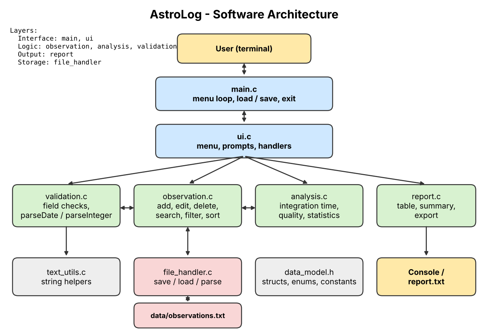

# AstroLog: Telescope Observation Log Manager

**Engineering domain:** Education / Laboratory management (amateur astronomy and astrophotography)

AstroLog is a command-line application written in C that keeps a validated, searchable log of telescope observing sessions and calculates how much usable data has been collected for each target.

## Problem Statement

In astronomy clubs and amateur observatories, observers and club coordinators currently face scattered, inconsistent and hard-to-search observation records. The current method results in missing or invalid entries, duplicate sessions, manual and error-prone calculation of total integration time, and no quick way to review past sessions. AstroLog provides validated record entry, file storage, search, filtering, sorting and summary reports so that users can quickly find past observations and judge how much usable data they have for each target.

## Proposed Solution

A modular C program that stores observation records in a text file, validates every input, calculates total integration time and a quality rating for each session, and produces summary reports.

## Features

- Add, edit and delete observation records (type `cancel` at any prompt to abort)
- Validation of every field (real calendar dates, ranges, text limits, duplicate IDs)
- Search by ID or part of the target name (case-insensitive)
- Filter by object type or date range; sort by date or total integration time
- Total integration time per record and per target
- Quality rating (Excellent / Good / Poor) from seeing and integration time
- Summary report on screen and exported to `data/report.txt`
- Safe saving: a failed save never destroys the previous data file

## Functional Requirements Summary

FR-01 add records, FR-02 validate fields, FR-03 reject duplicate IDs, FR-04 search, FR-05 edit and delete, FR-06 integration time, FR-07 quality rating, FR-08 filter, FR-09 sort, FR-10 save and load, FR-11 summary report, FR-12 handle invalid input and file errors. Full list: [docs/project_proposal.md](docs/project_proposal.md).

## Software Architecture



Details: [docs/detailed_design.md](docs/detailed_design.md).

## Module Descriptions

| Module | Files | Responsibility |
|---|---|---|
| Main | `src/main.c` | Load data, run the menu loop, save, exit (high-level control only) |
| UI | `src/ui.c`, `include/ui.h` | Menu, prompts, one handler per menu option, status messages |
| Observation | `src/observation.c`, `include/observation.h` | Add, edit, delete, search, filter, sort records |
| Validation | `src/validation.c`, `include/validation.h` | Field rules, strict parsing of numbers and dates |
| Analysis | `src/analysis.c`, `include/analysis.h` | Integration time, quality rating, statistics |
| File handler | `src/file_handler.c`, `include/file_handler.h` | Save, load and parse the data file |
| Report | `src/report.c`, `include/report.h` | Record table and summary report |
| Text utilities | `src/text_utils.c`, `include/text_utils.h` | Case-insensitive and whitespace string helpers |
| Data model | `include/data_model.h` | Structures, enumerations, constants, status codes |

## Folder Structure

```
astrolog/
|-- src/        C source files
|-- include/    header files
|-- tests/      Google Test files (C++)
|-- data/       sample_data.txt (working copy observations.txt is created by make run)
|-- docs/       project_proposal.md, detailed_design.md, architecture.png
|-- Makefile
|-- README.md
|-- .gitignore
`-- LICENSE
```

## C Concepts Used

Structures (`Observation_t`, `ObservationList_t`), enumerations (object type, quality, status codes), fixed-size arrays, strings with explicit limits, pointers and output parameters, named constants, function pointers (validator callbacks in the prompts), file handling (`fopen`, `fgets`, `fprintf`, `fflush`, `fclose`, `rename`), status codes with checked return values, header guards and `extern "C"` guards for C++ tests.

## Coding Standards Followed

camelCase functions and variables, PascalCase `_t` types, UPPER_SNAKE constants and enum values, 4-space indentation, braces on their own line, one statement per line, no globals, no magic numbers, every return value checked, `-Wall -Wextra -Wpedantic` with zero warnings. See section 8 of the detailed design.

## Prerequisites

- GCC and G++ (C11 and C++17 support)
- GNU Make
- Google Test development package

Ubuntu / Debian:

```
sudo apt install build-essential libgtest-dev
```

On older Ubuntu versions `libgtest-dev` ships sources only; build the libraries once with `cd /usr/src/gtest && sudo cmake . && sudo make && sudo cp lib/*.a /usr/lib` (or `cp *.a`). If Google Test lives in a non-standard location, set `GTEST_INC` and `GTEST_LIBS` when calling `make test`.

## Build Instructions

```
git clone https://github.com/<your-username>/astrolog.git
cd astrolog
make all
```

The executable is created as `build/astrolog`.

## Run Instructions

```
make run
```

The first run copies `data/sample_data.txt` to `data/observations.txt` so there is data to explore. You can also run `./build/astrolog path/to/file.txt` to use another data file. Choose `0` to save and exit.

## Test Instructions

```
make test
```

## Clean

```
make clean
```

## Sample Input

Data file (`data/sample_data.txt`), one record per line: `id|target|type|day|month|year|exposureSeconds|frameCount|seeing|notes`

```
ASTROLOG_V1
3|Orion Nebula M42|3|2|10|2026|30|120|4|Clear sky, guided
8|Andromeda Galaxy M31|4|6|11|2026|180|60|5|Best night of the month
```

Object types: 0 Moon, 1 Planet, 2 Star, 3 Nebula, 4 Galaxy, 5 Cluster, 6 Other.

Interactive example (add a record): `1`, Enter (accept suggested ID), `Orion Nebula M42`, `4`, `15-11-2026`, `60`, `100`, `4`, `Guided, light haze`.

## Sample Output

Menu option 2 (list all):

```
ID     Date       Target               Type     Exp x Frames Total         See Quality
3      02-10-2026 Orion Nebula M42     Nebula   30s x 120    1h 00m 00s    4   Excellent
8      06-11-2026 Andromeda Galaxy M31 Galaxy   180s x 60    3h 00m 00s    5   Excellent
```

Menu option 8 (summary report, with the sample data):

```
=========== ASTROLOG SUMMARY REPORT ===========
Total sessions     : 10
Total integration  : 8h 53m 20s (8.89 h)
Average seeing     : 3.50 / 5
Most imaged target : Andromeda Galaxy M31 (4h 20m 00s)
Quality ratings    : Excellent 3 | Good 4 | Poor 3
Sessions by object type:
  Moon     : 1
  Planet   : 2
  Star     : 1
  Nebula   : 3
  Galaxy   : 2
  Cluster  : 1
  Other    : 0
===============================================
```

Invalid input example:

```
Exposure per frame in seconds: 5000
Invalid value. Enter a whole number from 1 to 3600.
```

## Unit-Testing Summary

Google Test, 86 test cases in five files (`test_validation`, `test_observation`, `test_analysis`, `test_file_handler`, `test_report`) covering validation, record management, search, filter, sort, calculations, statistics, file round-trip, file errors and report output. Positive, negative and boundary cases are included. Tests build their own data, use temporary files that are deleted afterwards, and do not depend on each other or on user input.

## Error-Handling Summary

Every fallible function returns a `Status_t`, and every return value is checked. Invalid input is re-prompted, never crashes the program, and never changes stored data. A missing or empty data file starts an empty log. A corrupt data file stops the program with the line number and leaves the file untouched. Saving writes a temporary file and renames it, so a failed save keeps the previous file. Catalogue of errors: section 7 of the detailed design.

## Student Information

| Field | Details |
|---|---|
| Name | [Your name] |
| Roll number | [Roll number] |
| Division / batch | [Division / batch] |

## Known Limitations

1. At most 200 records (fixed array).
2. Command-line interface only; text-file storage only.
3. Editing re-enters all fields of a record (the ID cannot be changed).
4. Dates before 2000 or after 2100 are rejected.
5. Target names and notes cannot contain the `|` character.

## Future Enhancements

1. Dynamic memory so the log can grow without a fixed limit.
2. Export to CSV for spreadsheets.
3. Equipment and filter fields, and per-target progress goals.
4. Import of catalogue data (Messier / NGC names).

## GitHub Repository

[https://github.com/<your-username>/astrolog](https://github.com/<your-username>/astrolog)
