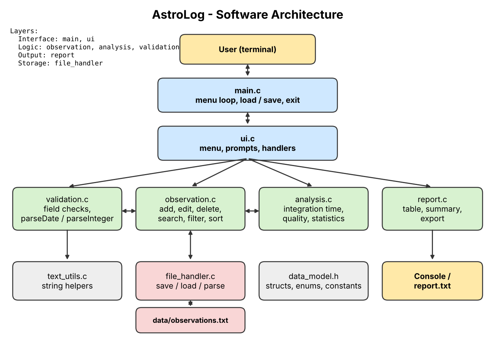
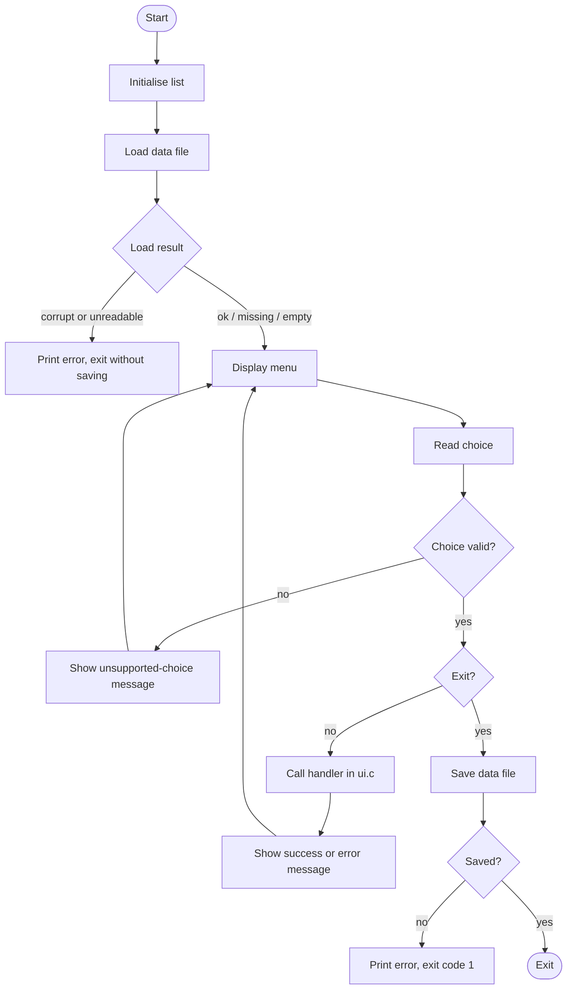
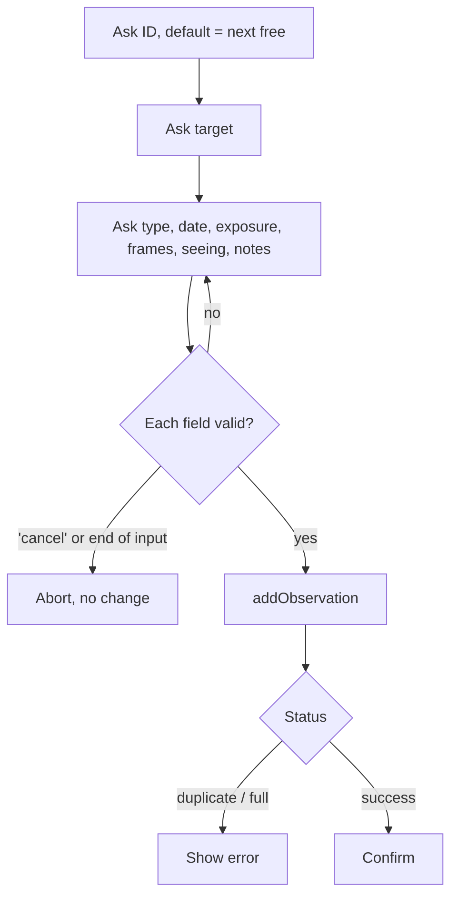
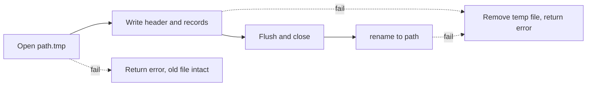

# Detailed Software Design: AstroLog

## 1. Software Architecture

AstroLog is organised in four layers. Each module has one responsibility, and dependencies only point downwards (no cycles).

| Layer | Modules | Role |
|---|---|---|
| Interface | `main.c`, `ui.c` | Menu, prompts, messages, high-level flow |
| Application logic | `observation.c`, `analysis.c`, `validation.c` | Record handling, calculations, rules |
| Output | `report.c` | Tables and summary report |
| Storage | `file_handler.c` | Text-file persistence |
| Shared | `data_model.h`, `text_utils.c` | Types and constants; string helpers |



Dependency rules: `text_utils` and `data_model.h` depend on nothing; `validation` and `analysis` use them; `observation` uses `validation`, `analysis` and `text_utils`; `file_handler` uses `observation` and `validation`; `report` uses `analysis` and `observation`; `ui` uses all of them; `main` uses `ui`, `file_handler` and `observation`.

## 2. Module Design

| Module | Source / header | Purpose | Public functions | Depends on | Status codes returned |
|---|---|---|---|---|---|
| main | `main.c` / none | Application flow | `main` | ui, file_handler, observation | none (exit code) |
| ui | `ui.c` / `ui.h` | Menu, prompts, handlers | `displayMenu`, `readMenuChoice`, `handle*` (9), `getStatusMessage` | all modules | `STATUS_CANCELLED`, `STATUS_INPUT_*` (internal) |
| observation | `observation.c` / `observation.h` | Record collection | `initObservationList`, `addObservation`, `findObservationIndexById`, `findObservationsByTarget`, `filterByObjectType`, `filterByDateRange`, `updateObservation`, `deleteObservation`, `sortObservations`, `getNextFreeId`, `compareDates`, `objectTypeToString` | validation, analysis, text_utils | NULL_POINTER, DUPLICATE_ID, NOT_FOUND, EMPTY_COLLECTION, CAPACITY_FULL, INVALID_* |
| validation | `validation.c` / `validation.h` | Rules and parsing | `isValid*` (8), `validateObservation`, `parseDate`, `parseInteger` | text_utils | INVALID_*, NULL_POINTER |
| analysis | `analysis.c` / `analysis.h` | Calculations | `calculateIntegrationSeconds`, `determineQuality`, `calculateTargetIntegrationSeconds`, `calculateStatistics`, `secondsToHours`, `qualityToString` | text_utils | EMPTY_COLLECTION, NULL_POINTER |
| file_handler | `file_handler.c` / `file_handler.h` | Persistence | `saveObservations`, `loadObservations`, `parseRecordLine` | observation, validation, text_utils | FILE_* , CAPACITY_FULL |
| report | `report.c` / `report.h` | Output | `formatDuration`, `printObservationTable`, `printSummaryReport`, `exportSummaryReport` | analysis, observation | EMPTY_COLLECTION, FILE_* |
| text_utils | `text_utils.c` / `text_utils.h` | String helpers | `stringEqualsIgnoreCase`, `stringContainsIgnoreCase`, `trimTrailingWhitespace`, `isBlankString`, `copyText` | none | none |

`ui.c` owns the user-facing parts only. `main.c` contains the loop and calls the handlers; it holds the only list instance (a local variable, no globals).

## 3. Data Design

### 3.1 Structures

**`Date_t`**: `int day, month, year`.

**`Observation_t`**: one observing session.

| Member | C type | Valid range or size | Description |
|---|---|---|---|
| `id` | `int` | 1 to 999999, unique | Log number |
| `target` | `char[41]` | 1 to 40 chars, not blank, no `|` or control characters | Name of the object, e.g. "Orion Nebula M42" |
| `type` | `ObjectType_t` | `OBJ_MOON` .. `OBJ_OTHER` | Object category |
| `date` | `Date_t` | real calendar date, 2000 to 2100 | Observation date |
| `exposureSeconds` | `int` | 1 to 3600 | Exposure per frame |
| `frameCount` | `int` | 1 to 10000 | Number of frames |
| `seeing` | `int` | 1 to 5 | Sky steadiness (1 bad, 5 excellent) |
| `notes` | `char[81]` | 0 to 80 chars, no `|` or control characters | Free text |

Derived values (total integration time and quality) are **calculated, not stored**, so they can never become inconsistent with the stored fields.

**`ObservationList_t`**: `Observation_t items[200]` and `int count` (0 to 200).

**`SessionStats_t`**: totals, average seeing, counts per quality and per object type, most imaged target and its total time.

### 3.2 Enumerations

| Enumeration | Constants |
|---|---|
| `ObjectType_t` | `OBJ_MOON`, `OBJ_PLANET`, `OBJ_STAR`, `OBJ_NEBULA`, `OBJ_GALAXY`, `OBJ_CLUSTER`, `OBJ_OTHER`, `OBJ_TYPE_COUNT` |
| `Quality_t` | `QUALITY_POOR`, `QUALITY_GOOD`, `QUALITY_EXCELLENT`, `QUALITY_COUNT` |
| `SortKey_t` | `SORT_BY_DATE`, `SORT_BY_INTEGRATION` |
| `Status_t` | see section 9 |
| `MenuChoice_t` | `MENU_INVALID`, `MENU_EXIT`, `MENU_ADD` .. `MENU_EXPORT_REPORT` |

### 3.3 Constants (`data_model.h`)

| Constant | Value | Purpose |
|---|---|---|
| `MAX_OBSERVATIONS` | 200 | Record capacity |
| `MAX_TARGET_LEN` / `MAX_NOTES_LEN` | 40 / 80 | Text limits |
| `MIN_ID` / `MAX_ID` | 1 / 999999 | ID range |
| `MIN_YEAR` / `MAX_YEAR` | 2000 / 2100 | Year range |
| `MIN_/MAX_EXPOSURE_SECONDS` | 1 / 3600 | Exposure range |
| `MIN_/MAX_FRAME_COUNT` | 1 / 10000 | Frame range |
| `MIN_/MAX_SEEING` | 1 / 5 | Seeing range |
| `EXCELLENT_MIN_SEEING`, `EXCELLENT_MIN_SECONDS` | 4, 3600 | Excellent rating thresholds |
| `GOOD_MIN_SEEING`, `GOOD_MIN_SECONDS` | 3, 600 | Good rating thresholds |
| `FIELD_DELIMITER`, `RECORD_FIELD_COUNT` | `'|'`, 10 | File format |
| `DATA_FILE_HEADER` | `"ASTROLOG_V1"` | First line of the data file |
| `DEFAULT_DATA_FILE`, `REPORT_FILE` | `data/observations.txt`, `data/report.txt` | Default paths |
| `INPUT_BUFFER_SIZE`, `LINE_BUFFER_SIZE` | 128, 256 | Buffers for input and file lines |

### 3.4 Quality Rule

| Rating | Condition |
|---|---|
| Excellent | seeing >= 4 **and** total integration >= 3600 s |
| Good | seeing >= 3 **and** total integration >= 600 s (and not Excellent) |
| Poor | everything else |

Total integration = `exposureSeconds x frameCount` (stored in a `long` to avoid overflow: the maximum is 36,000,000 s).

### 3.5 Data Dictionary

| Data item | C type | Valid range or size | Validation rule | Description |
|---|---|---|---|---|
| id | int | 1 to 999999 | `isValidId`; unique in list | Observation number |
| target | char[41] | 1 to 40 | `isValidTargetName` | Object name |
| type | ObjectType_t | 0 to 6 | `isValidObjectType` | Category |
| date | Date_t | 2000 to 2100 | `isValidDate` (leap years handled) | Session date |
| exposureSeconds | int | 1 to 3600 | `isValidExposure` | Seconds per frame |
| frameCount | int | 1 to 10000 | `isValidFrameCount` | Frames taken |
| seeing | int | 1 to 5 | `isValidSeeing` | Sky steadiness |
| notes | char[81] | 0 to 80 | `isValidNotes` | Remarks |
| integration seconds | long | 1 to 36,000,000 | calculated | exposure x frames |

## 4. Function Design

Conventions: unless stated, a function returns `STATUS_NULL_POINTER` for a NULL pointer argument and never modifies its outputs on failure.

### 4.1 Validation module

| Function | Purpose / behaviour | Return | Errors |
|---|---|---|---|
| `bool isValidDate(Date_t date)` | Real calendar date, year 2000 to 2100, leap years included | true / false | invalid date gives false |
| `bool isValidTargetName(const char *name)` | 1 to 40 characters, not blank, no `|` or control characters | true / false | NULL gives false |
| `bool isValidExposure(int)`, `isValidFrameCount(int)`, `isValidSeeing(int)`, `isValidId(int)`, `isValidObjectType(int)` | Range checks against the named constants | true / false | out of range gives false |
| `bool isValidNotes(const char *notes)` | At most 80 characters, no `|` or control characters (empty allowed) | true / false | NULL gives false |
| `Status_t validateObservation(const Observation_t *obs)` | Checks all fields in a fixed order | `STATUS_SUCCESS` or the first failing `STATUS_INVALID_*` | NULL gives `STATUS_NULL_POINTER` |
| `Status_t parseDate(const char *text, Date_t *date)` | Parses `DD-MM-YYYY`, rejects trailing text and impossible dates; `*date` only changes on success | `STATUS_SUCCESS`, `STATUS_INVALID_DATE` | NULL gives `STATUS_NULL_POINTER` |
| `Status_t parseInteger(const char *text, int *value)` | Strict whole-number parse (uses `strtol`, checks end pointer and range) | `STATUS_SUCCESS`, `STATUS_INVALID_ARGUMENT` | empty, text, overflow |

### 4.2 Observation module

| Function | Parameters (direction) | Return | Preconditions | Postconditions | Errors |
|---|---|---|---|---|---|
| `Status_t addObservation(ObservationList_t *list, const Observation_t *obs)` | list (in/out), obs (in) | `STATUS_SUCCESS` | list initialised | on success `count` grows by 1 and the record is last | invalid field, `DUPLICATE_ID`, `CAPACITY_FULL` |
| `Status_t findObservationIndexById(const ObservationList_t *list, int id, int *indexOut)` | list (in), id (in), indexOut (out) | `SUCCESS` / `NOT_FOUND` | none | `*indexOut` set only on success | NULL pointers |
| `int findObservationsByTarget(list, keyword, indices, maxIndices)` | indices (out) | number found, or -1 | none | `indices[0..n-1]` hold matching positions in list order | NULL, blank keyword, negative max (-1) |
| `int filterByObjectType(list, type, indices, maxIndices)` | indices (out) | number found, or -1 | none | as above | NULL, invalid type (-1) |
| `int filterByDateRange(list, from, to, indices, maxIndices)` | indices (out) | number found, or -1 | none | both end dates are included | invalid date, `from` after `to` (-1) |
| `Status_t updateObservation(list, id, newData)` | list (in/out) | `SUCCESS` | none | record keeps the given `id`; list unchanged on any failure | invalid field, `NOT_FOUND` |
| `Status_t deleteObservation(list, id)` | list (in/out) | `SUCCESS` | none | `count` shrinks by 1, order of the others preserved | `EMPTY_COLLECTION`, `NOT_FOUND` |
| `Status_t sortObservations(list, key)` | list (in/out) | `SUCCESS` | none | stable insertion sort: date ascending, or integration descending | invalid key (`INVALID_ARGUMENT`) |
| `int getNextFreeId(const ObservationList_t *list)` | list (in) | smallest unused ID | none | result is a valid, unused ID | none |
| `int compareDates(Date_t a, Date_t b)` | values | -1, 0 or 1 | none | none | none |

### 4.3 Analysis module

| Function | Purpose | Return | Errors |
|---|---|---|---|
| `long calculateIntegrationSeconds(const Observation_t *obs)` | exposure x frames | seconds | NULL gives 0 |
| `Quality_t determineQuality(int seeing, long integrationSeconds)` | Applies the rule in 3.4 | `Quality_t` | none |
| `long calculateTargetIntegrationSeconds(list, target)` | Sum over records with an equal target name (ignoring case) | seconds | NULL gives 0 |
| `Status_t calculateStatistics(list, stats)` | Totals, average seeing, counts, most imaged target | `SUCCESS` | `EMPTY_COLLECTION`, `NULL_POINTER` |
| `double secondsToHours(long seconds)` | seconds / 3600 | hours | none |

### 4.4 File handler

| Function | Purpose | Return | Errors |
|---|---|---|---|
| `Status_t saveObservations(list, path)` | Writes `path.tmp`, flushes, closes, then renames over `path` | `SUCCESS` | `FILE_OPEN_FAILED`, `FILE_WRITE_FAILED`, `INVALID_ARGUMENT` (path too long) |
| `Status_t loadObservations(list, path, errorLine)` | Empties the list, checks the header, parses and adds each line; list is empty again on failure | `SUCCESS` | `FILE_NOT_FOUND`, `FILE_OPEN_FAILED`, `FILE_EMPTY`, `FILE_INVALID_DATA` (with line number), `FILE_READ_FAILED`, `CAPACITY_FULL` |
| `Status_t parseRecordLine(const char *line, Observation_t *obs)` | Splits on `|`, parses 10 fields, validates the record | `SUCCESS` | `FILE_INVALID_DATA` |

### 4.5 Report module

| Function | Purpose | Return | Errors |
|---|---|---|---|
| `void formatDuration(long totalSeconds, char *buffer, size_t size)` | "Xh YYm ZZs"; negative shown as zero | none | NULL / zero size ignored |
| `void printObservationTable(FILE *out, list, indices, count)` | Table of the selected records (all if `indices` is NULL) | none | prints "No records to display." when count <= 0 |
| `Status_t printSummaryReport(FILE *out, list)` | Statistics report | `SUCCESS` | `EMPTY_COLLECTION`, `FILE_WRITE_FAILED` |
| `Status_t exportSummaryReport(list, path)` | Report written to a file | `SUCCESS` | `FILE_OPEN_FAILED`, `FILE_WRITE_FAILED`, `EMPTY_COLLECTION` |

## 5. Input-Validation Plan

| Input | Source | Rule | Invalid example | Behaviour |
|---|---|---|---|---|
| Menu choice | User | whole number 0 to 9 | `abc`, `12`, empty | "Unsupported menu choice", menu shown again |
| ID | User / file | whole number 1 to 999999, unique | `0`, `abc`, duplicate | re-prompt; duplicate gives "already exists" |
| Target | User / file | 1 to 40 chars, not blank, no `|`, no control characters | empty, `M31|x` | re-prompt |
| Object type | User / file | 1 to 7 on screen (0 to 6 in file) | `9`, `x` | re-prompt |
| Date | User / file | `DD-MM-YYYY`, real date, 2000 to 2100 | `31-02-2026`, `2026-08-15` | re-prompt |
| Exposure | User / file | whole number 1 to 3600 | `0`, `5000` | re-prompt |
| Frames | User / file | whole number 1 to 10000 | `0` | re-prompt |
| Seeing | User / file | whole number 1 to 5 | `9` | re-prompt |
| Notes | User / file | 0 to 80 chars, no `|` | 81 characters | re-prompt |
| Any prompt | User | line shorter than the buffer | very long line | "Input is too long", rest of line discarded, re-prompt |
| Any prompt | User | `cancel` | | operation aborted, nothing changed |
| End of input | User | Ctrl-D | | prompt aborted; at the menu the program saves and exits |
| Search text | User | not blank | empty | "Search text cannot be empty" |
| Date range | User | start not after end | 2026 to 2025 | "Invalid filter" message |
| File header | File | first line `ASTROLOG_V1` | other text | load fails, line 1 reported |
| File record | File | 10 fields, all valid, unique ID | too few fields | load fails, line number reported |

**Strategy.** Every field has one validator in `validation.c`. The prompt functions in `ui.c` receive the validator as a function pointer, so interactive input, record validation (`addObservation`, `updateObservation`) and file loading all use the same rules and cannot disagree. Input is read with `fgets` (never `gets` or unbounded `scanf`) and numbers are parsed with `strtol` plus an end-pointer check.

## 6. File-Handling Design

### 6.1 File Summary

| File | Purpose | Format | Created by | Read by | Updated by |
|---|---|---|---|---|---|
| `data/observations.txt` | Persistent log | Text | `saveObservations` (or `make run` copies the sample) | `loadObservations` | `saveObservations` on exit |
| `data/observations.txt.tmp` | Safe-save scratch file | Text | `saveObservations` | none | removed or renamed immediately |
| `data/report.txt` | Exported summary | Text | `exportSummaryReport` | the user | rewritten on each export |
| `data/sample_data.txt` | Demo data (committed) | Text | author | `make run` copies it once | never by the program |

### 6.2 Record Format

Line 1 is the header `ASTROLOG_V1`. Every following line is one record with ten `|`-separated fields:

```
id|target|type|day|month|year|exposureSeconds|frameCount|seeing|notes
8|Andromeda Galaxy M31|4|6|11|2026|180|60|5|Best night of the month
```

`type` is the numeric value of `ObjectType_t`. Notes may be empty (the line then ends with `|`). Blank lines are ignored on load.

### 6.3 File Operations

| Operation | Function | C library function | Failure handling |
|---|---|---|---|
| Open for reading | `loadObservations` | `fopen(path, "r")` | `ENOENT` gives `FILE_NOT_FOUND` (first run: start empty); other errors give `FILE_OPEN_FAILED` |
| Read | `readAllRecords` (internal) | `fgets`, `ferror`, `feof` | too-long line or bad record gives `FILE_INVALID_DATA` with line number; `ferror` gives `FILE_READ_FAILED` |
| Open for writing | `saveObservations` | `fopen(path.tmp, "w")` | `FILE_OPEN_FAILED` |
| Write | `writeAllRecords` (internal) | `fprintf`, `fflush`, `ferror` | negative return gives `FILE_WRITE_FAILED` |
| Close | both | `fclose` | non-zero gives `FILE_WRITE_FAILED` / `FILE_READ_FAILED` |
| Replace | `saveObservations` | `rename` | failure gives `FILE_WRITE_FAILED`; temporary file removed |

### 6.4 File Error Conditions

| Condition | Detection | Behaviour |
|---|---|---|
| File does not exist | `fopen` fails with `ENOENT` | "No existing data", start with an empty log |
| File cannot be opened | `fopen` fails otherwise | Error message, program exits without changing anything |
| File is empty | `fgets` returns NULL on first read | Treated like a missing file, empty log |
| File contains invalid data | header or record check fails | Error with line number; program exits **without overwriting** the file |
| Read or write fails | `ferror`, `fprintf` < 0, `fclose` != 0 | Error message; on save the old file stays intact |

## 7. Error-Handling Strategy

### 7.1 Status Representation

All fallible functions return `Status_t` (`STATUS_SUCCESS = 0`). Functions that return a count return -1 for invalid arguments. `ui.c::getStatusMessage` converts every code into a user-readable sentence, so the lower modules never print.

### 7.2 Error Catalogue

| ID | Condition | Detected in | Status | User-facing behaviour |
|---|---|---|---|---|
| ERR-01 | NULL pointer argument | every public function | `STATUS_NULL_POINTER` | internal error message |
| ERR-02 | Field out of range or malformed | `validateObservation` | `STATUS_INVALID_*` | specific message; prompts re-ask |
| ERR-03 | Duplicate ID | `addObservation` | `STATUS_DUPLICATE_ID` | "A record with this ID already exists." |
| ERR-04 | Missing record | find / update / delete | `STATUS_NOT_FOUND` | "No record found." |
| ERR-05 | Nothing to process | `deleteObservation`, `calculateStatistics` | `STATUS_EMPTY_COLLECTION` | "There are no records yet." |
| ERR-06 | List full (200) | `addObservation` | `STATUS_CAPACITY_FULL` | "The log is full." |
| ERR-07 | File missing / empty | `loadObservations` | `STATUS_FILE_NOT_FOUND`, `STATUS_FILE_EMPTY` | start with an empty log |
| ERR-08 | File cannot be opened | load, save, export | `STATUS_FILE_OPEN_FAILED` | error message |
| ERR-09 | Corrupt data file | `loadObservations` | `STATUS_FILE_INVALID_DATA` | message with line number, exit, file untouched |
| ERR-10 | Read or write failure | load, save, export | `STATUS_FILE_READ_FAILED`, `STATUS_FILE_WRITE_FAILED` | error message |
| ERR-11 | Input too long / end of input / cancel | `ui.c` prompts | `STATUS_INPUT_TOO_LONG`, `STATUS_INPUT_EOF`, `STATUS_CANCELLED` | re-prompt or operation aborted |

### 7.3 Recovery Strategy

- Invalid interactive input never leaves the prompt until it is valid or the user types `cancel`.
- A failed operation never changes the record list (validation happens before any change).
- A corrupt data file stops the program before the user can change anything, and the file is never overwritten, so nothing is lost.
- Saving uses a temporary file and `rename`, so a crash or full disk during a save keeps the last good file.
- Every return value is checked; the only deliberately ignored call is the best-effort `remove` of the temporary file, which is marked with `(void)`.

## 8. Coding Standards Plan

| Item | Convention | Example |
|---|---|---|
| Source / header files | lowercase with underscores | `file_handler.c`, `file_handler.h` |
| Functions | camelCase, verb first | `findObservationsByTarget` |
| Variables | camelCase | `integrationSeconds` |
| Structures / enumerations | PascalCase with `_t` suffix | `Observation_t`, `Status_t` |
| Enumeration constants | UPPER_SNAKE with a prefix | `STATUS_NOT_FOUND`, `OBJ_NEBULA` |
| Macros / constants | UPPER_SNAKE | `MAX_OBSERVATIONS` |

- Indentation: 4 spaces, no tabs. Braces on their own line. One statement per line. Spaces around operators.
- Compiler flags: `-std=c11 -Wall -Wextra -Wpedantic`. The build must produce no warnings.
- Comments explain purpose, assumptions and non-obvious logic; every header documents its public functions.
- Function rules: one responsibility, check pointer arguments, validate inputs, return a status, avoid side effects.
- Prohibited: logic in `main.c`, globals, magic numbers, unchecked return values, `gets` / unbounded `scanf` / `strcpy`, duplicated logic, unused code, commented-out code, machine-specific absolute paths in the program.

## 9. Application Flow

### 9.1 Main Flow



### 9.2 Add Observation



### 9.3 Safe Save



## 10. Unit-Test Plan

Framework: Google Test (C++ test files, C headers with `extern "C"` guards). Test files: `tests/test_validation.cpp`, `test_observation.cpp`, `test_analysis.cpp`, `test_file_handler.cpp`, `test_report.cpp`, with shared helpers in `test_helpers.hpp`.

### 10.1 Functions Selected for Testing

| Function(s) | Module | Reason |
|---|---|---|
| `isValid*`, `validateObservation`, `parseDate`, `parseInteger` | validation | Core of the input-validation requirement |
| `addObservation`, `findObservationIndexById`, `findObservationsByTarget`, `updateObservation`, `deleteObservation` | observation | Record insertion, search, modification, deletion |
| `filterByObjectType`, `filterByDateRange`, `sortObservations`, `getNextFreeId`, `compareDates` | observation | Filtering and sorting logic |
| `calculateIntegrationSeconds`, `determineQuality`, `calculateTargetIntegrationSeconds`, `calculateStatistics`, `secondsToHours` | analysis | Calculations and decisions |
| `saveObservations`, `loadObservations`, `parseRecordLine` | file_handler | File round-trip and file errors |
| `formatDuration`, `printSummaryReport`, `exportSummaryReport` | report | Report calculation and output |

### 10.2 Test Cases (representative; all in the `tests/` folder)

| Test ID | Function | Category | Input or condition | Expected result | Requirement |
|---|---|---|---|---|---|
| UT-01 | `isValidDate` | Positive | 15-08-2026 | true | FR-02 |
| UT-02 | `isValidDate` | Negative | 31-04-2026, month 13, day 0 | false | FR-02 |
| UT-03 | `isValidDate` | Boundary | 29-02-2028 vs 29-02-2027; years 1999, 2000, 2100, 2101 | leap day only in leap year; range edges enforced | FR-02 |
| UT-04 | `isValidExposure` / `Frame` / `Seeing` / `Id` | Boundary | min-1, min, max, max+1 | false, true, true, false | FR-02 |
| UT-05 | `isValidTargetName` | Negative | NULL, empty, blank, contains `|` | false | FR-02 |
| UT-06 | `isValidTargetName` | Boundary | 40 vs 41 characters | true / false | FR-02 |
| UT-07 | `parseDate` | Negative | `2026-08-15`, `15-08-2026x`, `31-02-2026` | `STATUS_INVALID_DATE`, output unchanged | FR-02, FR-12 |
| UT-08 | `parseInteger` | Negative | `abc`, `12abc`, empty, overflow | `STATUS_INVALID_ARGUMENT` | FR-12 |
| UT-09 | `addObservation` | Positive | valid record | success, count + 1 | FR-01 |
| UT-10 | `addObservation` | Negative | same ID twice | `STATUS_DUPLICATE_ID`, count unchanged | FR-03 |
| UT-11 | `addObservation` | Negative | exposure 0 | `STATUS_INVALID_EXPOSURE` | FR-02 |
| UT-12 | `addObservation` | Boundary | 201st record | `STATUS_CAPACITY_FULL` | FR-12 |
| UT-13 | `findObservationsByTarget` | Positive | "NEBULA" matches "Orion Nebula" | 1 match | FR-04 |
| UT-14 | `findObservationIndexById` | Negative | unknown ID | `STATUS_NOT_FOUND` | FR-04 |
| UT-15 | `updateObservation` | Positive / Negative | new data; invalid data | updated with same ID; unchanged on failure | FR-05 |
| UT-16 | `deleteObservation` | Positive / Negative | middle record; missing; empty list | gap closed; `NOT_FOUND`; `EMPTY_COLLECTION` | FR-05 |
| UT-17 | `filterByDateRange` | Boundary | range ending exactly on a record date; reversed range | end dates included; -1 | FR-08 |
| UT-18 | `sortObservations` | Positive | by date, by integration | ascending dates; longest first | FR-09 |
| UT-19 | `calculateIntegrationSeconds` | Boundary | 3600 s x 10000 frames | 36,000,000 (no overflow) | FR-06 |
| UT-20 | `determineQuality` | Boundary | (4, 3600), (4, 3599), (3, 600), (3, 599) | Excellent, Good, Good, Poor | FR-07 |
| UT-21 | `calculateTargetIntegrationSeconds` | Positive | "M31" and "m31" records | summed, case-insensitive | FR-06 |
| UT-22 | `calculateStatistics` | Positive / Negative | 3 records; empty list | correct totals and best target; `EMPTY_COLLECTION` | FR-11 |
| UT-23 | `saveObservations` / `loadObservations` | Positive | save then load | all fields identical | FR-10 |
| UT-24 | `loadObservations` | Negative | missing, empty, wrong header, short line, duplicate IDs | specific status and line number; list empty | FR-10, FR-12 |
| UT-25 | `saveObservations` | Negative | path in a missing directory | `STATUS_FILE_OPEN_FAILED` | FR-12 |
| UT-26 | `parseRecordLine` | Positive / Negative | valid; bad type; extra field | success; `FILE_INVALID_DATA` | FR-10 |
| UT-27 | `formatDuration` | Positive / Boundary | 3725 s; 0; negative | `1h 02m 05s`; zero text | FR-11 |
| UT-28 | `printSummaryReport` | Positive / Negative | one record; empty list | text contains totals; `EMPTY_COLLECTION` | FR-11 |

The actual test files contain more granular cases (86 `TEST` / `TEST_F` cases in total); each test checks one behaviour, creates its own data, and does not depend on any other test.

### 10.3 Test Data and Setup

- Records are built by `makeObservation()` in `test_helpers.hpp`; no user input is needed.
- File tests use a fixture that creates a unique temporary file with `mkstemp` in `SetUp` and deletes it (and any `.tmp` file) in `TearDown`, so tests are independent and repeatable.
- Report output is captured with `tmpfile()`.

### 10.4 Expected Test Command

```
make test
```

## 11. Makefile Design

### 11.1 Targets

| Target | Purpose | Expected output |
|---|---|---|
| `all` | Build the application | `build/astrolog` |
| `run` | Build, copy the sample data on first use, start the application | interactive menu |
| `test` | Build and run all unit tests | gTest summary, exit code 0 when all pass |
| `clean` | Remove generated files | `build/` and `data/report.txt` removed |

### 11.2 Build Configuration

| Item | Planned value |
|---|---|
| C compiler | `gcc` |
| C++ compiler | `g++` |
| C compiler flags | `-std=c11 -Wall -Wextra -Wpedantic -O2 -Iinclude` |
| C++ compiler flags | `-std=c++17 -Wall -Wextra -Wpedantic -O2 -Iinclude` |
| Include paths | `include/` (extra gTest path via `GTEST_INC`) |
| gTest libraries | `-lgtest -lgtest_main -lpthread` (override with `GTEST_LIBS`) |
| Application executable | `build/astrolog` |
| Test executable | `build/run_tests` |

Each source file is compiled to its own object file. Header dependencies are generated with `-MMD -MP`, so only changed files are rebuilt. `data/observations.txt` is the user's working copy and is **not** removed by `make clean`.

## 12. Requirement Traceability

| Requirement | Module | Function or feature | Tests |
|---|---|---|---|
| FR-01 | observation, ui | `addObservation`, `handleAddObservation` | UT-09 |
| FR-02 | validation | `validateObservation`, `isValid*` | UT-01 to UT-08, UT-11 |
| FR-03 | observation | duplicate check in `addObservation` | UT-10 |
| FR-04 | observation | `findObservationIndexById`, `findObservationsByTarget` | UT-13, UT-14 |
| FR-05 | observation | `updateObservation`, `deleteObservation` | UT-15, UT-16 |
| FR-06 | analysis | `calculateIntegrationSeconds`, `calculateTargetIntegrationSeconds` | UT-19, UT-21 |
| FR-07 | analysis | `determineQuality` | UT-20 |
| FR-08 | observation | `filterByObjectType`, `filterByDateRange` | UT-17 |
| FR-09 | observation | `sortObservations` | UT-18 |
| FR-10 | file_handler | `saveObservations`, `loadObservations`, `parseRecordLine` | UT-23 to UT-26 |
| FR-11 | analysis, report | `calculateStatistics`, `printSummaryReport`, `exportSummaryReport` | UT-22, UT-27, UT-28 |
| FR-12 | all | status codes, validation, file checks | UT-07, UT-08, UT-12, UT-24, UT-25 |

## 13. Repository Structure

```
astrolog/
|-- src/
|   |-- main.c
|   |-- ui.c
|   |-- observation.c
|   |-- validation.c
|   |-- analysis.c
|   |-- file_handler.c
|   |-- report.c
|   `-- text_utils.c
|-- include/
|   |-- data_model.h
|   |-- ui.h
|   |-- observation.h
|   |-- validation.h
|   |-- analysis.h
|   |-- file_handler.h
|   |-- report.h
|   `-- text_utils.h
|-- tests/
|   |-- test_helpers.hpp
|   |-- test_validation.cpp
|   |-- test_observation.cpp
|   |-- test_analysis.cpp
|   |-- test_file_handler.cpp
|   `-- test_report.cpp
|-- data/
|   `-- sample_data.txt
|-- docs/
|   |-- project_proposal.md
|   |-- detailed_design.md
|   `-- architecture.png
|-- Makefile
|-- README.md
|-- .gitignore
`-- LICENSE
```

## 14. Git and GitHub Plan

| Milestone | Planned commit message |
|---|---|
| Repository creation | Create initial project structure |
| Documentation | Add project proposal and architecture diagram |
| Documentation | Add detailed software design |
| Data design | Add data model with structures, enums and constants |
| Utilities | Add text utility functions |
| Validation | Implement input validation and parsing |
| Core module | Implement observation record management |
| Analysis | Add integration-time and quality calculations |
| File handling | Add file-storage module with safe save |
| Output | Add table and summary report module |
| Interface | Add menu and user-interface handlers |
| Main | Add application entry point |
| Build | Add Makefile with all, run, test and clean targets |
| Unit testing | Add validation unit tests |
| Unit testing | Add observation and analysis unit tests |
| Unit testing | Add file-handler and report unit tests |
| Data | Add sample data and .gitignore |
| Documentation | Add README and LICENSE |

`.gitignore` excludes `build/`, `*.o`, `*.d`, `*.out`, `*.exe`, `*.log`, `core`, the working data file `data/observations.txt`, the generated `data/report.txt`, and editor files.
