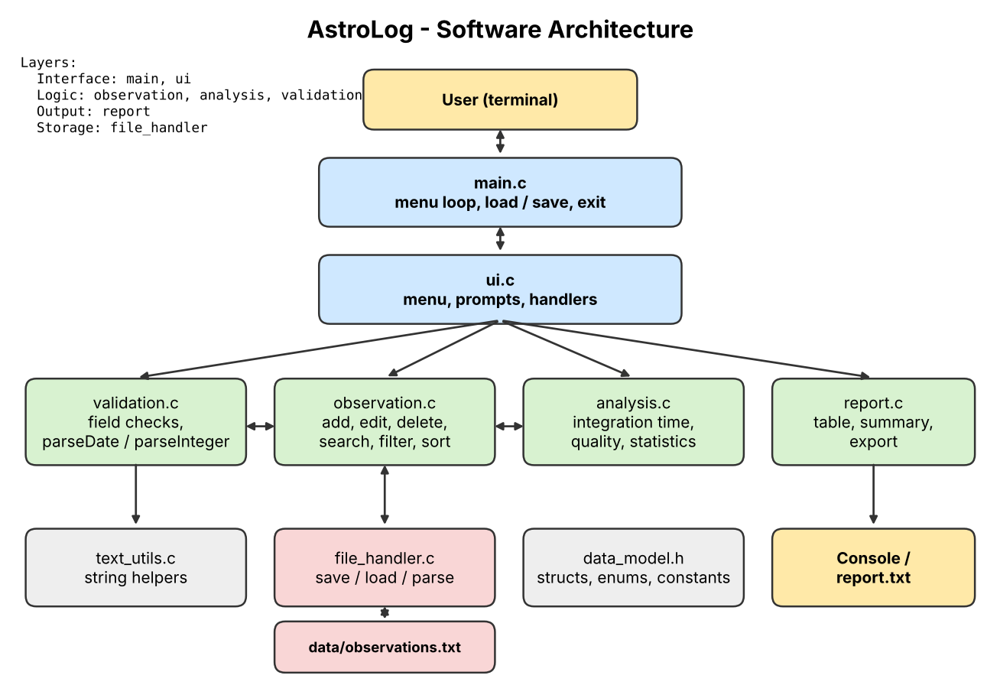
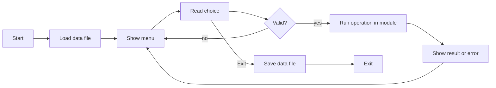

# Project Proposal: AstroLog, Telescope Observation Log Manager

## 1. Project Information

| Field | Details |
|---|---|
| Project title | AstroLog: Telescope Observation Log Manager |
| Engineering domain | Education / Laboratory management (amateur astronomy and astrophotography) |
| Student name | [Your name] |
| Roll number | [Roll number] |
| Division / batch | [Division / batch] |
| Repository name | astrolog |
| GitHub repository link | [https://github.com/your-username/astrolog] |

**Individual project declaration.** I confirm that this project is my individual work. I understand the design, source code, unit tests, Makefile and documentation in this repository, and I am prepared to explain or modify any part during evaluation.

Acknowledgement: [Your name, date]

## 2. Engineering Scenario

Astronomy clubs and amateur astrophotographers run observing sessions in which they photograph or observe targets such as the Moon, planets, nebulae and galaxies. For every session they note the target, date, exposure time per frame, number of frames, sky conditions (seeing) and remarks. Observers and club coordinators later need this information to see how much usable data they have collected for each target, to compare sessions, and to report on club activity.

Today this information is kept in notebooks and scattered spreadsheets. Entries are inconsistent, easily mistyped and hard to search, and totals such as integration time are calculated by hand.

### 2.1 Problem Statement

In astronomy clubs and amateur observatories, observers and club coordinators currently face scattered, inconsistent and hard-to-search observation records. The current method results in missing or invalid entries, duplicate sessions, manual and error-prone calculation of total integration time, and no quick way to review past sessions. The proposed software will provide validated record entry, file storage, search, filtering, sorting and summary reports so that users can quickly find past observations and judge how much usable data they have for each target.

### 2.2 Proposed Solution

AstroLog is a command-line application written in C. It will:

- add, edit, delete and search observation records;
- validate every input (date, exposure, frame count, seeing rating, identifiers, text);
- store records in a text file and load them when the program starts;
- calculate the total integration time of every record and of every target;
- classify each observation as Excellent, Good or Poor from its seeing rating and integration time;
- filter records by object type or date range and sort them by date or integration time;
- generate a summary report (sessions, total integration time, average seeing, most imaged target, quality counts, sessions by object type) on screen or as a text file.

### 2.3 Target Users

| User type | Responsibility | How the user will use the application |
|---|---|---|
| Astrophotographer | Captures and processes images | Logs sessions and checks total integration time per target |
| Club coordinator | Organises club observing nights | Reviews sessions and exports summary reports |
| Student member | Learns observing practice | Searches and filters past observations for reference |

## 3. Project Scope

### 3.1 In-Scope Features
1. Add, edit and delete observation records
2. Input validation for all fields
3. Search by ID and by target name
4. Filter by object type and by date range
5. Sort by date and by total integration time
6. Integration-time calculation and quality classification
7. Summary report on screen and as a file
8. Saving to and loading from a text file

### 3.2 Out-of-Scope Features
1. Graphical user interface
2. Telescope or camera control
3. Image processing or online catalogue lookup
4. Multi-user access or networking

### 3.3 Assumptions
1. One user works with one data file on one machine.
2. Dates are entered as DD-MM-YYYY, years 2000 to 2100.
3. The log holds at most 200 records.

### 3.4 Constraints
1. Command-line interface only.
2. Plain text file storage (no database).
3. Fixed maximum number of records (no dynamic memory needed).
4. Individual project with limited development time.

## 4. Requirements

### 4.1 Functional Requirements

| ID | Functional requirement | Priority | Verification |
|---|---|---|---|
| FR-01 | The system shall add a new observation record. | High | Test / demonstration |
| FR-02 | The system shall validate every field of a record before storing it. | High | Test |
| FR-03 | The system shall reject a record whose ID already exists. | High | Test |
| FR-04 | The system shall search records by ID and by part of the target name. | High | Test |
| FR-05 | The system shall edit and delete an existing record. | Medium | Test |
| FR-06 | The system shall calculate the total integration time of a record and of a target. | High | Test |
| FR-07 | The system shall determine a quality rating for each record. | Medium | Test |
| FR-08 | The system shall filter records by object type and by date range. | Medium | Test |
| FR-09 | The system shall sort records by date or by total integration time. | Medium | Test |
| FR-10 | The system shall save records to a file and load them at start-up. | High | Test / demonstration |
| FR-11 | The system shall generate a summary report on screen and as a file. | Medium | Test / demonstration |
| FR-12 | The system shall handle invalid input and file errors without crashing. | High | Negative testing |

### 4.2 Non-Functional Requirements

| ID | Non-functional requirement | Verification |
|---|---|---|
| NFR-01 | The source code shall compile without warnings (`-Wall -Wextra -Wpedantic`). | Build output |
| NFR-02 | The project shall use a modular multi-file structure. | Code review |
| NFR-03 | The application shall handle invalid input without crashing. | Negative testing |
| NFR-04 | Important functions shall be tested using Google Test. | Unit-test output |
| NFR-05 | The project shall build using a Makefile (`all`, `run`, `test`, `clean`). | Build demonstration |
| NFR-06 | The project shall be maintained in a GitHub repository with meaningful commits. | Repository review |
| NFR-07 | A failed save shall never destroy the previously saved data file. | Test |

## 5. Initial Modules

| Module | Files | Responsibility |
|---|---|---|
| Main | `main.c` | High-level control: load, menu loop, save, exit |
| User interface | `ui.c`, `ui.h` | Menu, prompts, one handler per menu option |
| Observation | `observation.c`, `observation.h` | Record collection: add, edit, delete, search, filter, sort |
| Validation | `validation.c`, `validation.h` | Field validation and strict parsing of numbers and dates |
| Analysis | `analysis.c`, `analysis.h` | Integration time, quality rating, statistics |
| File handler | `file_handler.c`, `file_handler.h` | Saving, loading and parsing of the data file |
| Report | `report.c`, `report.h` | Record table and summary report output |
| Text utilities | `text_utils.c`, `text_utils.h` | Shared case-insensitive and whitespace string helpers |

## 6. Initial Architecture

## 7. High-Level Workflow

## 8. Planned C Concepts

| Concept | Why it is needed |
|---|---|
| Structures | `Observation_t` and `ObservationList_t` represent records and the collection |
| Enumerations | Object type, quality rating, sort key and status codes |
| Arrays | Fixed-capacity record store; index lists for search and filter results |
| Strings | Target names and notes, with explicit length limits |
| Pointers | Passing records and the list to functions; output parameters |
| Constants | All limits and thresholds are named constants |
| Function pointers | Validator callbacks in the prompt functions avoid duplicated input loops |
| File handling | `fopen`, `fgets`, `fprintf`, `fclose`, `rename` for persistent storage |
| Status codes | Every operation returns a `Status_t` that callers check |
| Dynamic memory | Not used: a fixed array of 200 records is sufficient and simpler |
